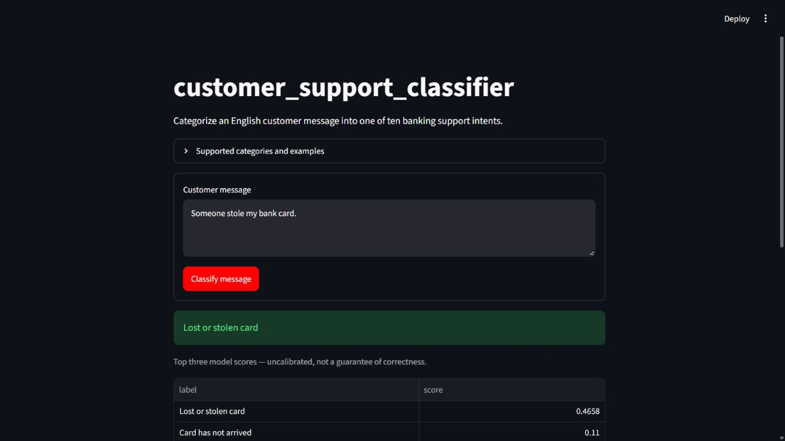
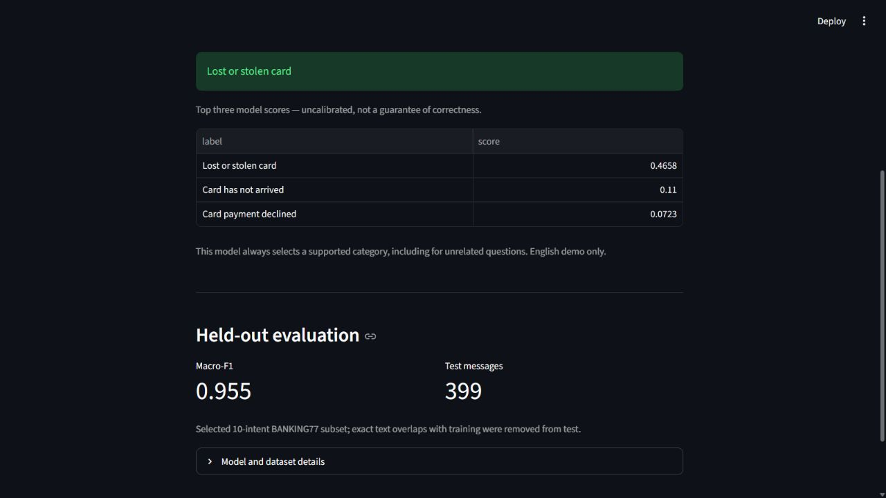
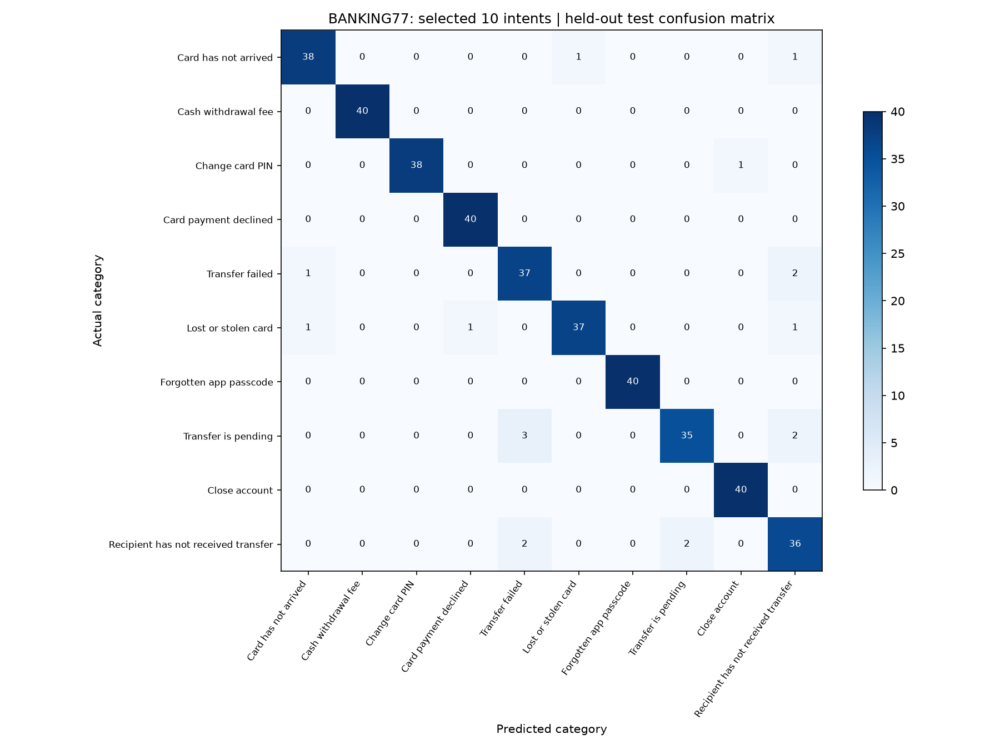

# customer_support_classifier

Classify English banking support messages into **10 customer intents** using TF-IDF and Logistic Regression. Includes data preparation, a validation-based comparison with Naive Bayes, held-out evaluation, a saved model, and an interactive Streamlit application.

> **Example:** “Someone stole my bank card.” → **Lost or stolen card**

## App preview





Screenshots show the app running locally. A public hosted demo has not been deployed yet.

## Features

- Predict one of ten banking support intents from an English message.
- Display the top three category scores in a Streamlit interface.
- Compare Logistic Regression and Multinomial Naive Bayes using validation macro-F1.
- Audit empty messages, exact duplicates, conflicting labels, and train/test overlaps.
- Save per-class metrics, a confusion matrix, error examples, and run metadata.
- Run predictions through the web interface or a command-line script.

## How it works

```text
TRAINING
BANKING77 CSVs → select 10 intents → audit data → fit/validation split
              → compare TF-IDF classifiers → choose by validation macro-F1
              → refit on training subset → evaluate on test subset → save model

PREDICTION
Customer message → saved TF-IDF vectorizer → trained classifier → category + scores
```

TF-IDF represents messages using weighted word and word-pair features. Logistic Regression learns how those features relate to the supported categories. The fitted vectorizer and classifier are saved together in a scikit-learn `Pipeline`.

## Supported categories

| Intent | Meaning |
| --- | --- |
| `card_arrival` | Card has not arrived |
| `lost_or_stolen_card` | Lost or stolen card |
| `passcode_forgotten` | Forgotten app passcode |
| `change_pin` | Change card PIN |
| `cash_withdrawal_charge` | Cash withdrawal fee |
| `declined_card_payment` | Card payment declined |
| `pending_transfer` | Transfer is pending |
| `transfer_not_received_by_recipient` | Recipient has not received transfer |
| `failed_transfer` | Transfer failed |
| `terminate_account` | Close account |

## Results

The final model was trained on **1,355 messages** and evaluated on **399 held-out messages** from the audited, selected-intent BANKING77 subset.

| Method | Test accuracy | Test macro-F1 |
| --- | ---: | ---: |
| Majority-class baseline | 10.03% | 0.0182 |
| **TF-IDF + Logistic Regression** | **95.49%** | **0.9551** |

Model selection used a separate validation split:

| Candidate | Validation accuracy | Validation macro-F1 |
| --- | ---: | ---: |
| Logistic Regression | 96.31% | 0.9627 |
| Multinomial Naive Bayes | 93.36% | 0.9302 |



See [full results](reports/RESULTS.md), [metrics and parameters](reports/metrics.json), [per-class metrics](reports/classification_report.csv), and [incorrect predictions](reports/errors.csv).

### Evaluation method

1. Keep the official BANKING77 training and test partitions separate; filter both to the ten supported intents.
2. Remove empty messages, within-partition conflicting labels, and exact duplicates after lowercasing and whitespace normalization.
3. Remove exact normalized training overlaps from the test partition only.
4. Split the cleaned training subset into 80% fit and 20% validation data, stratified by category, with random seed 42.
5. Compare two fixed candidate pipelines using validation macro-F1.
6. Refit the selected pipeline on the cleaned training subset and evaluate on the held-out test subset.

The TF-IDF vocabulary and weights are learned inside each training pipeline. Test data does not select the classifier or its parameters. The audit removed one training duplicate and one train/test overlap. Similar paraphrases may remain. These measurements are **not results on the complete 77-intent BANKING77 benchmark**.

## Quick start

Use **Python 3.12**. The repository includes a trained model so you can run the demo without retraining.

```bash
git clone https://github.com/a1ifhossain/customer_support_classifier.git
cd customer_support_classifier
python -m venv .venv
```

Activate the environment:

```powershell
# Windows PowerShell
.\.venv\Scripts\Activate.ps1
```

```bash
# macOS / Linux
source .venv/bin/activate
```

Install dependencies and start the application:

```bash
python -m pip install -r requirements.txt
python -m streamlit run app.py --browser.gatherUsageStats false
```

Open the local URL printed by Streamlit, usually `http://localhost:8501`.

On Windows you can also double-click `start_demo.cmd` after installing dependencies. If PowerShell activation is unavailable, run commands using `.\.venv\Scripts\python.exe` directly; no execution-policy change is needed.

### Command-line prediction

```bash
python predict.py "Someone stole my bank card"
```

### Reproduce training

```bash
python prepare_data.py
python train.py
```

The supplied raw CSV snapshot is reused and checked against recorded SHA-256 hashes. If files are missing, the preparation script downloads them from the original repository. Training regenerates the model and reports. Restart the app after retraining to clear its cached model.

### Run checks

```bash
python -m pip install -r requirements-dev.txt
python -m pytest tests -q
```

Checks cover duplicate/conflict handling, a vectorizer leakage boundary, train/test overlap, saved-model predictions, input validation, and the Streamlit form.

## Project structure

```text
customer_support_classifier/
├── app.py                  # Streamlit interface
├── config.py               # Intents, examples, paths, and seed
├── prepare_data.py         # Download, select, clean, and audit data
├── train.py                # Compare, train, evaluate, and save models
├── predict.py              # Shared inference function and CLI
├── requirements.txt        # Tested runtime dependencies
├── requirements-dev.txt    # Test dependency
├── artifacts/              # Saved pipeline and model metadata
├── data/
│   ├── raw/                # Original CSV snapshot and manifest
│   └── prepared/           # Audited 10-intent subsets
├── docs/screenshots/       # App screenshots
├── reports/                # Metrics, plots, predictions, and errors
├── tests/                  # Automated checks
├── START_HERE.md           # Local setup and first steps
└── LEARN_WITH_ME.md         # Beginner explanations and exercises
```

## Technology

Python · pandas · scikit-learn · NumPy · SciPy · joblib · Matplotlib · Streamlit · pytest

## Limitations

- English messages in ten selected banking categories only.
- Always chooses a supported category, including for unrelated input; no trained unknown-intent detector.
- Top-three scores are uncalibrated and are not verified probabilities of correctness.
- Messages containing several requests receive one predicted category.
- Results on this small benchmark subset do not establish performance on live requests.
- Run metadata is stored locally; public deployment, a model registry, live monitoring, and automated retraining are not implemented.

## Possible improvements

- Evaluate unknown-intent rejection using a dedicated validation set.
- Expand to more intents and test difficult paraphrases.
- Add probability calibration, an inference API, and MLflow experiment tracking.
- Deploy the app and measure inference latency.

## Dataset and acknowledgments

This project uses **BANKING77**, published by PolyAI:

- [Original dataset repository](https://github.com/PolyAI-LDN/task-specific-datasets)
- [Paper: Efficient Intent Detection with Dual Sentence Encoders](https://arxiv.org/abs/2003.04807) — Casanueva et al., 2020
- [Dataset license: Creative Commons Attribution 4.0 International](https://creativecommons.org/licenses/by/4.0/)

The prepared dataset selects ten intents and applies the documented audit. Raw CSVs retain their original content. Source URLs and file hashes are recorded in `data/raw/source_manifest.json`.

Developed with AI assistance as a learning project. The accompanying guides explain the implementation and evaluation decisions.
